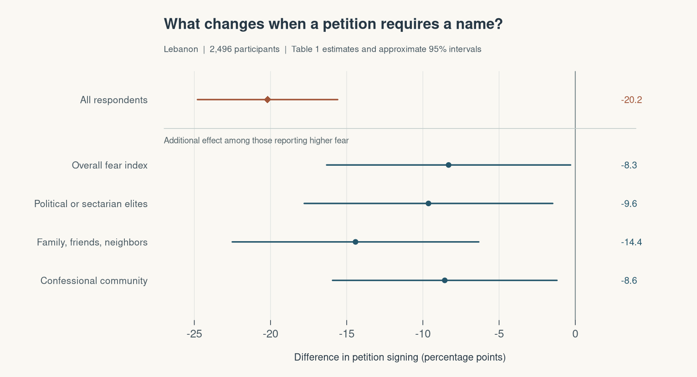

# When a petition in Lebanon required a name

**An R replication of Paler, Marshall and Atallah’s petition experiment, with a new randomization test.** [اقرأ البحث بالعربية](summary-ar.md)

In a study of 2,496 Lebanese adults, 877 of 1,248 people signed a petition for political reform when they could omit their name. Of the 1,248 asked to give their name, 625 signed. The same petition drew **20.19 percentage points less participation** when signing meant being identifiable to political and sectarian leaders. Counting only public signatures would have understated how many people were willing to endorse reform without giving their name.

| Petition condition | Signed | Assigned | Signing rate |
| --- | ---: | ---: | ---: |
| Age, confession and district only (private condition) | 877 | 1,248 | 70.27% |
| Name required (public condition) | 625 | 1,248 | 50.08% |



## Reproducing Table 1

All **24 coefficients and 24 clustered standard errors** across the five models match the printed table at two decimals. Column 1 regresses completed signing on assignment, with fixed effects for the randomization blocks and standard errors clustered by primary sampling unit (PSU). Exactly half of each block received each version, so the adjusted coefficient also equals the raw difference in signing rates. Its clustered standard error is 2.35 percentage points. [Full comparison with published values](table-1.csv)

Columns 2–5 ask whether disclosure matters more among people who anticipated social sanctions. The R code reconstructs the fear index separately in each of the ten completed datasets, fits the interaction models, and combines the estimates and variances using Rubin’s rules. In column 4 the estimated reduction was another 14.42 points among people who expressed greater fear of disapproval from family, friends or neighbors. Random assignment identifies the effect of the name requirement. Fear itself was measured before assignment, so comparisons across fear groups have a different interpretation.

## Could random assignment produce a gap this large?

The extension holds each person’s signing decision fixed under the sharp null of no effect for anyone. In small communities, whole PSUs switched petition versions together. In larger ones, the design assigned individuals within PSUs and set sex targets. The test preserves these distinctions and calculates the distribution of the treatment coefficient by enumerating possible cluster assignments and combining exact counts of possible individual assignments. It uses no simulation seed.

The archive contains **one 16-person block** labeled for small-area assignment that has a single recorded PSU and both treatments. The primary test holds those assignments fixed. For the other individual assignments it conditions on the observed public count within each PSU and recorded-sex group. The original target schedule is unavailable in the analysis file. The probabilities below are exact for the stated reconstruction. [Randomization code](randomization.R) · [All four checks](randomization-tests.csv)

| Assignment check | Participants | Public minus private | Two-sided sharp-null p |
| --- | ---: | ---: | ---: |
| Full sample, ambiguous block fixed | 2,496 | −20.19 pp | 7.35 × 10⁻²² |
| Ambiguous block omitted | 2,480 | −20.16 pp | 1.14 × 10⁻²¹ |
| Only clearly cluster-assigned areas | 784 | −16.33 pp | 0.0043 |

Even the most restricted comparison, using 98 whole PSUs across 24 blocks, detects a drop in signing. The archive and the article’s appendix give slightly different PSU counts. All calculations here use the released observations. Participants offered the private petition still supplied age, confession and electoral district. The result identifies the added effect of requiring a name in this setting. It cannot distinguish every motive for withholding one.

## Reproduce

From the repository root, run the following in a terminal. R 4.5.0 and readstata13 0.11.0 were used for the reported results.

```sh
Rscript -e 'install.packages("readstata13", repos="https://cloud.r-project.org")'
Rscript replicate.R
```

The script downloads the archived Stata file from Harvard Dataverse, checks its published MD5 checksum and regenerates the figure and three CSVs. To use a local copy and a separate output folder, run `Rscript replicate.R /path/to/lebsurv_petition_pf_REP.dta results`. The public repository contains aggregate results. Respondent-level data remain in the authors’ archive.

Laura Paler, Leslie Marshall and Sami Atallah. 2018. “The Social Costs of Public Political Participation: Evidence from a Petition Experiment in Lebanon.” *The Journal of Politics* 80(4), 1405–1410. The authors designed the experiment and collected the data. This portfolio project adds the R implementation, assignment checks and bilingual interpretation. AI assistance was used to develop the code, verify results and draft both language versions. [Article](https://doi.org/10.1086/698714) · [Design appendix](https://laurapaler.com/wp-content/uploads/2018/03/social_costs_petition_append_ca.pdf) · [Replication archive, version 1, CC0](https://doi.org/10.7910/DVN/ZSB0BL)
